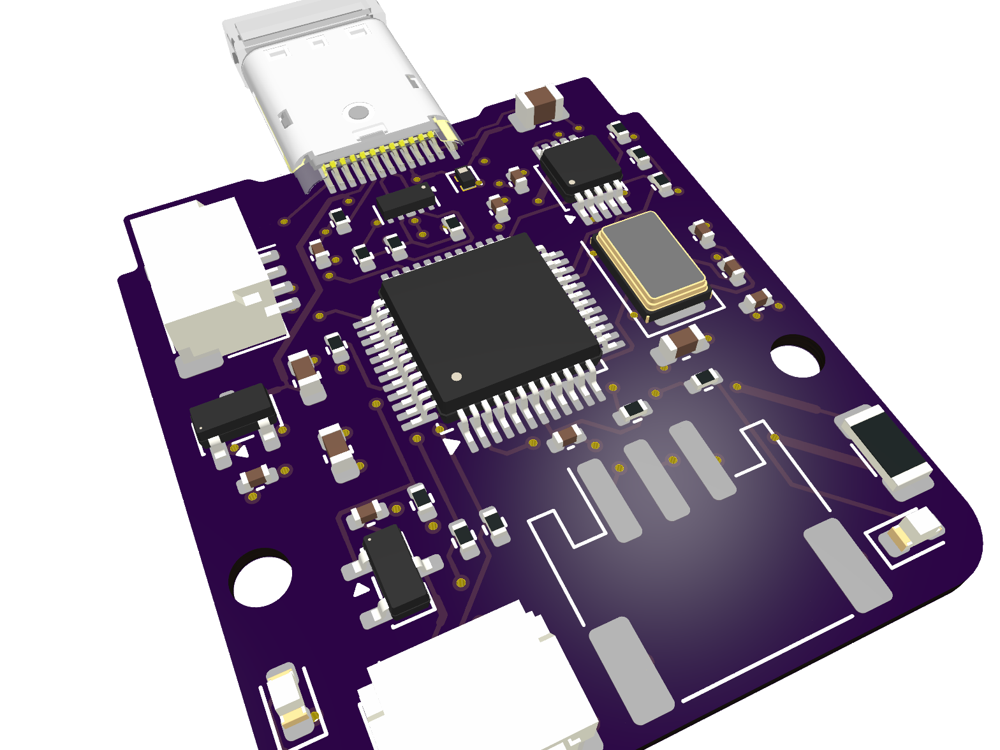

# Day 05 — USB-C I2C/Qwiic Bridge & 36V/5A Power Telemetry Probe



A flush-fit **Framework Expansion Card** (`26.0 × 30.0 × 0.8 mm`, 4-layer ENIG) that turns any laptop bay into an always-packed embedded bring-up Swiss Army knife:

1. **4-Pin 1.0 mm Qwiic / STEMMA QT I2C Host Bridge (`J2`)** — Probe, scan, and script 3.3 V I2C sensors directly from Python or C on the host without hunting for breadboards or dangling dongles. Includes high-side `AO3401A` target power switching (`QWIIC_PWR_EN_N`) for hard-resetting wedged sensors and MCU-switchable `4.7 kΩ` pull-ups (`QWIIC_PU_EN`).
2. **36 V / 5 A Bidirectional High-Side Power Monitor (`J3` + `U4` `INA226AIDGSR`)** — Measures external DC rail voltage (`0–36 V`, `1.25 mV` LSB), bidirectional shunt current (`200 µA` LSB across a `20 mΩ` `1%` `1206` shunt `R8`), and power (`5 mW` LSB) with hardware `~Alert` interrupt reporting.
3. **Single-Sided Standard PCBA** — Every component sits on `F.Cu` using widely stocked surface-mount parts from the fab's stock (`0402`/`0603`/`0805`/`1206` passives, `SOT-23`, `MSOP-10`, `UDFN-10`, `LQFP-48`).

---

## Architecture & Pin Map

| Subsystem | Key Parts | MCU Connections (`STM32F103C8T6`) | Notes |
|---|---|---|---|
| **USB-C Host Plug** | `12401981E412A`, `H5VL10B`, `D3V3XA4B10LP-7` | `PA11` (`USB_DM`), `PA12` (`USB_DP`), `PA8` (`USB_ENUM` `1.5 kΩ` pull-up) | `5.1 kΩ` `Rd` on `CC1` (`A5`); straddle-mount `0.8 mm` PCB tongue |
| **3.3 V Regulation** | `XC6206P332MR-G` (`SOT-23`) | Powers `VDD`/`VDDA` + switched `QWIIC_3V3` | `10 µF` + `4.7 µF` input/output MLCC bank + white `PWR_LED` (`D2`) |
| **Qwiic I2C Port** | `SM04B-SRSS-TB(LF)(SN)`, `AO3401A` | `PB6` (`I2C1_SCL`), `PB7` (`I2C1_SDA`), `PB4` (`QWIIC_PWR_EN_N`), `PB5` (`QWIIC_PU_EN`) | 5 V-tolerant I2C1 pins; software-controlled target power & pull-ups |
| **36 V / 5 A Probe** | `INA226AIDGSR`, `1206W3F200MT5E`, `S3B-PH-SM4-TB(LF)(SN)` | `PB10` (`I2C2_SCL`), `PB11` (`I2C2_SDA`), `PB12` (`INA_ALERT_N`) | 7-bit I2C addr `0x40`; `20 mΩ` `1%` shunt; `VIN` / `VLOAD` / `GND` header |
| **Clock & Debug** | `X50328MSB2GI` (`8 MHz`), `SM04B-SRSS-TB(LF)(SN)` (`J4`) | `PD0`/`PD1` (`HSE` -> `72 MHz` PLL), `PA13`/`PA14` (`SWDIO`/`SWCLK`), `PC13` (`ACT_LED`) | Internal 4-pin SWD header + red activity LED (`D3`) |

---

## Stackup & Fabrication (`Day_05_Power_Bus_Probe.fab.json`)

- **Dimensions:** `26.0 × 30.0 mm` (`0.8 mm` total thickness to mate with the Amphenol `12401981E412A` straddle-mount USB-C plug slot)
- **Layers:** 4-layer FR4 (`F.Cu` signals & components, `In1.Cu` solid `GND` plane, `In2.Cu` solid `+3V3` plane, `B.Cu` `GND` pour & short signal escapes)
- **Finish:** ENIG, blue solder mask, white silkscreen (`0.3 mm` min via drill / `0.6 mm` pad)

Re-run full verification (strict ERC, strict DRC with zone refill & schematic parity, Gerbers/Excellon drill, BOM, pick-and-place, STEP, and PNG renders):

```bash
python3 build.py
```

---

## Firmware (`firmware/`)

A self-contained bare-metal `STM32F103C8T6` firmware skeleton (`Makefile`, `stm32f103xb.ld`, `startup_stm32f103xb.s`, `main.c`) configures the `72 MHz` HSE PLL (`48 MHz` USB FS clock), disables JTAG to free `PB4` while keeping `SWD` active, powers up the `QWIIC_3V3` switch, calibrates the `INA226` (`CAL = 0x0500` for `20 mΩ` / `200 µA` LSB), scans the Qwiic bus (`0x08..0x77`), and attaches USB Full-Speed:

```bash
make -C firmware
```
