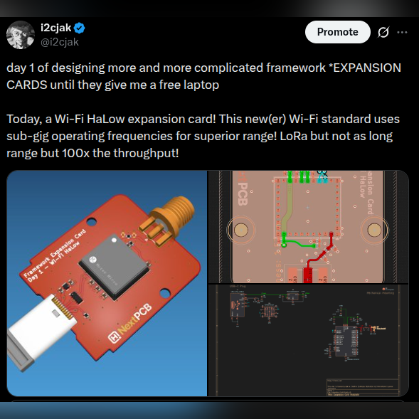
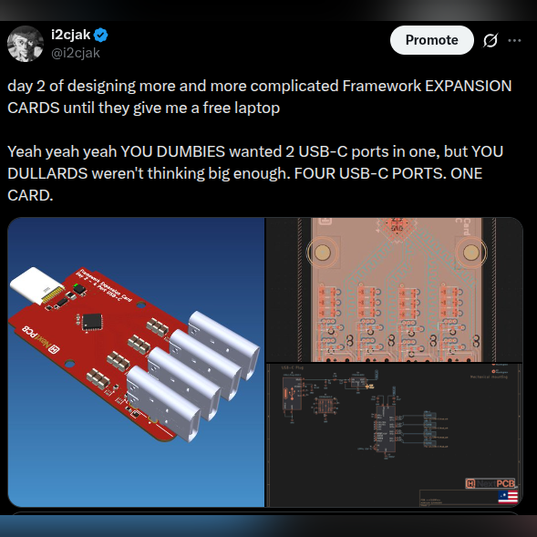
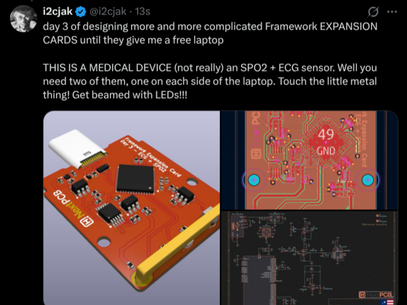
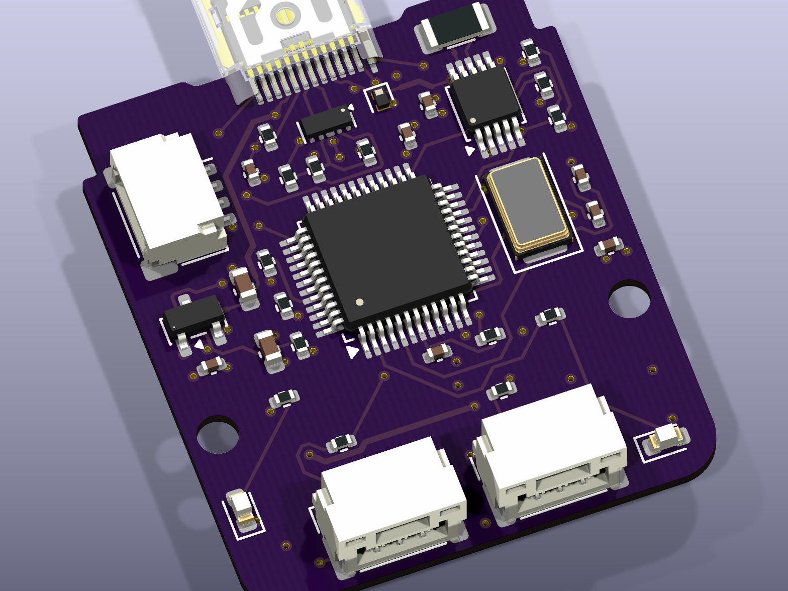
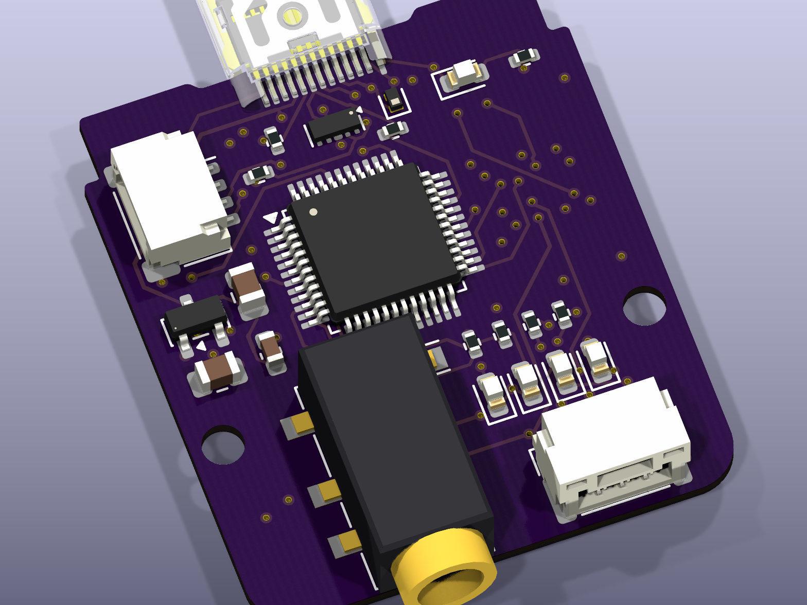
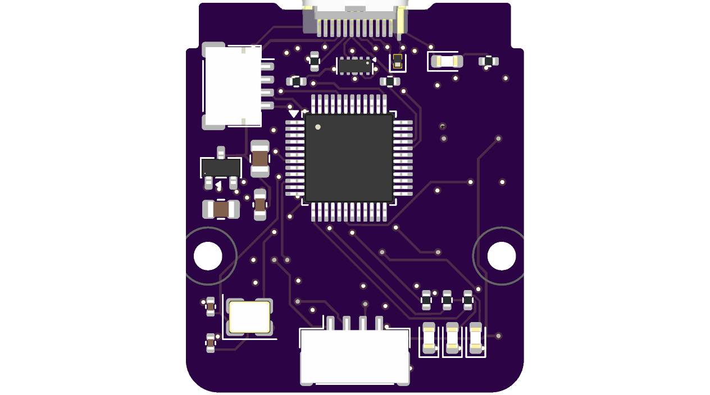
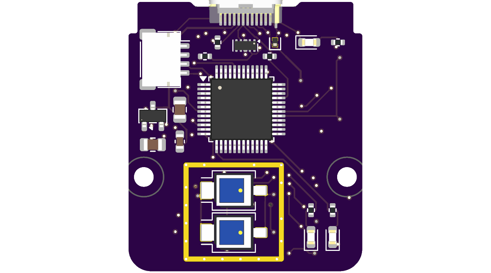
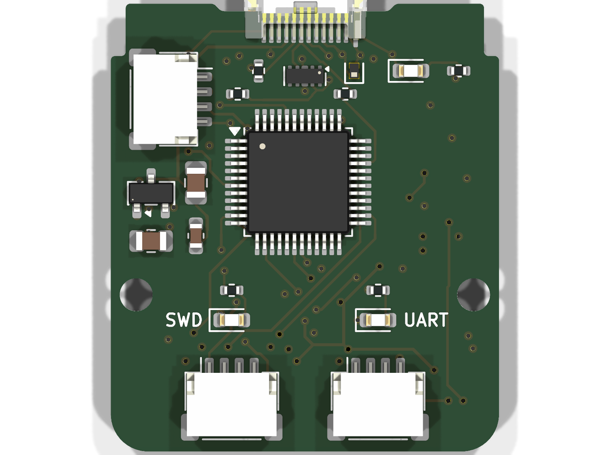
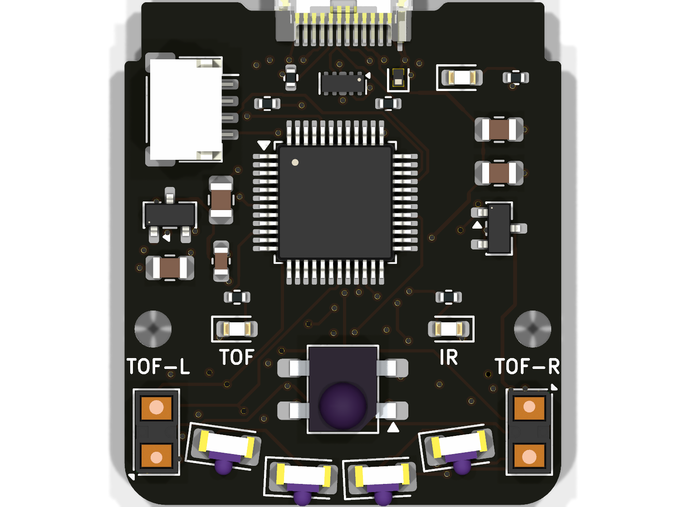
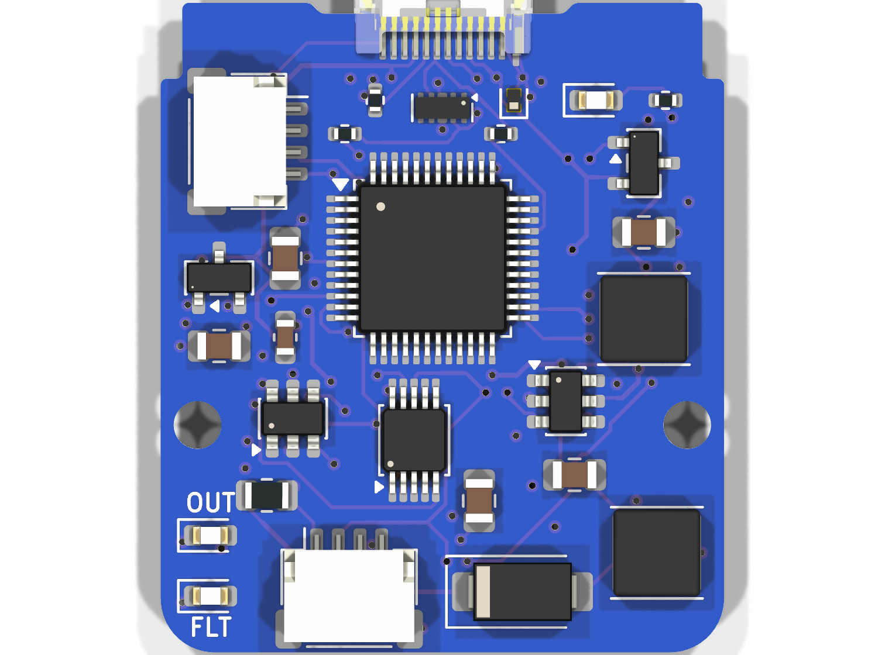

# i2cjak on X.com is THE foremost hardware engineer and poaster. he is designing one (1) new Framework Expansion Card per day until they give him a REALLY NICE laptop

# PROOF OF CHALLENGE!

  

## [Day 1](./Day_01_Wi-Fi-HaLow/)

Wi-Fi HaLow

  

## [Day 2](./Day_02_Four_Port_USB_C/)

Four Port USB-C

  

## [Day 3](./Day_03_ECG_SPO2/)

Electrocardiogram + SPO2

  

## [Day 4](./Day_04_Frameoscope/)

Frameoscope

  

## [Day 5](./Day_05_Power_Bus_Probe/)

USB-C I2C / Qwiic Bridge & 36V / 5A Power Telemetry Probe

  

## [Day 6](./Day_06_Walking_Legs/)

USB SOF-Synced 2-DOF Walking Leg Controller & Mechanical Bay Linkage (`mech/`)

  

## [Day 7](./Day_07_Chiptune_Synth_MIDI/)

Polyphonic FM / Chiptune 32-Bit I2S Synthesizer & Type-A MIDI Out

  

## [Day 8](./Day_08_CAN_Bus_Analyzer/)

1 Mbps ISO-11898 CAN 2.0B Bus Analyzer (`gs_usb` SocketCAN) & PhotoMOS 120R Termination

  

## [Day 9](./Day_09_Radiation_Dosimeter_RNG/)

Solid-State Dual-PIN Radiation Dosimeter, Pulse Spectrometer & Quantum Decay Hardware RNG

  

## [Day 10](./Day_10_SWD_Debugger_UART/)

Autoleveling 1.65V–5.5V CMSIS-DAPv2 High-Speed SWD Debugger & 6 Mbps UART Console

  

## [Day 11](./Day_11_ToF_Gesture_IR_Blaster/)

Dual 4m Laser Time-of-Flight Stereo Gesture Deck & Universal 940nm Phased-Arc IR Blaster

  

## [Day 12](./Day_12_Bench_Power_Supply/)

Programmable 1.0V–15.0V (4W) SEPIC Micro Bench Power Supply, 140µs E-Fuse & 4-Wire Kelvin Port

  

